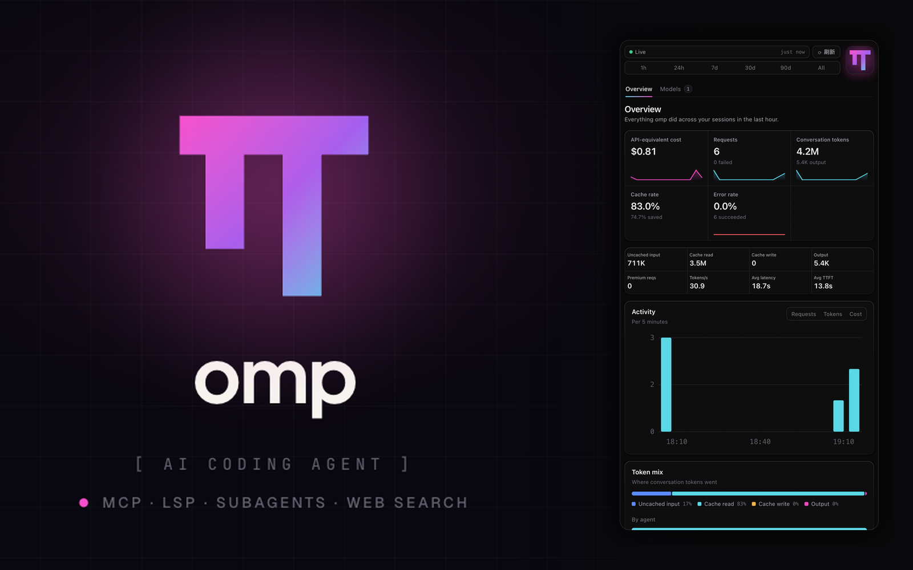
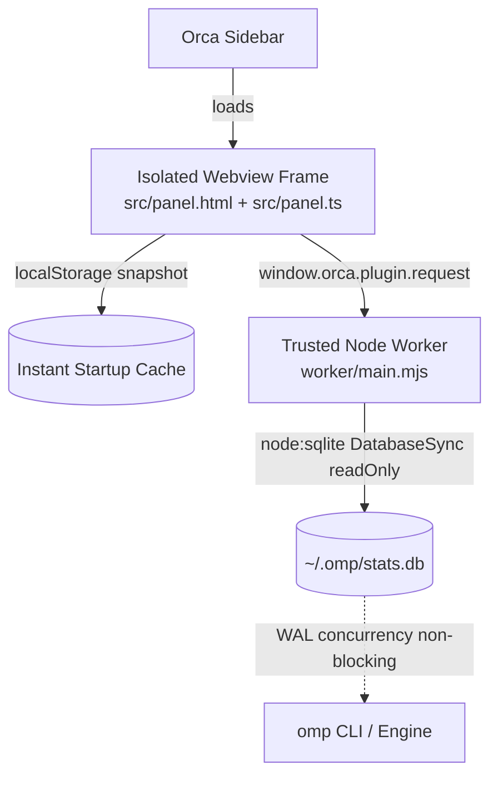

# OMP Stats · Orca Sidebar Plugin

[](#)
[](#)
[](#)
[](./LICENSE)

<p align="center">
  
</p>

Displays **omp** (Open Multimodal Proxy / AI Coding Agent) telemetry in the Orca sidebar with real-time usage monitoring, designed for Orca users working with omp. Directly queries `~/.omp/stats.db` in read-only mode via Node's embedded SQLite in **~9ms** with zero locks, providing 1:1 visual and data parity with omp's official web dashboard (`http://127.0.0.1:59127/`).

---

## Quick Install

```sh
orca plugin install turingfx/omp-stats
```

---

## Interface Layout

### Unified Top Control Bar
```
┌──────────────────────────────────────────────────────────────┐
│ [ ● Live ] [ Auto Off ▾ ] [ ⟳ Refresh ] ┌──────┐           │
│ ├─────────────────────────────────────┤ │      │           │
│ [  1h  |  24h  |  7d  |  30d  |  90d  |  All  ] │ π  │     │
│ └─────────────────────────────────────┘ └──────┘           │
│  Overview  |  Models (7)                                     │
└──────────────────────────────────────────────────────────────┘
```
- **Pixel-perfect alignment**: The status chip, auto/manual refresh buttons, and range segmented controls align vertically on both left and right edges.
- **Live status chip**: Pulsing indicator; hover shows the relative last-synced time.
- **Auto refresh selector**: `Off` / `1m` / `5m` / `10m` / `30m` interval dropdown; the chosen interval persists across reloads and re-arms on startup.
- **Dedicated manual refresh button**: Includes a `⟳` rotating animation and real-time `Syncing…` feedback.
- **6 Time ranges**: `1h` (5-min buckets), `24h` (1-hour buckets), `7d`, `30d`, `90d`, and `All`.
- **Glowing brand icon**: Centered geometric omp monogram extracted from the desktop banner asset with neon ambient glow.

---

## Features

### 1. Overview Tab (`#/overview`)
Mirrors `http://127.0.0.1:59127/#/overview`:

- **5 Primary Stat Cards (with SVG area sparklines)**:
  - `API-equivalent cost`: Estimated cost at public API rates with sparkline and unpriced request indicators.
  - `Requests`: Total request count and failure count with sparkline.
  - `Conversation tokens`: Total token burn and output tokens with sparkline.
  - `Cache rate`: Cache hit percentage and savings percentage.
  - `Error rate`: Error percentage and successful request count with sparkline.
- **8 Secondary Stat Cells (2×4 compact grid)**:
  `Uncached input` | `Cache read` | `Cache write` | `Output` | `Premium reqs` | `Tokens/s` | `Avg latency` | `Avg TTFT`
- **Activity Bar Chart**: Chronological request distribution with `Requests` (including failed request sub-bars in red), `Tokens`, and `Cost` toggle.
- **Token Mix & By Agent Breakdown**: 4-segment stacked share bar (Uncached input, Cache read, Cache write, Output) and Main agent vs. Subagents resource distribution.
- **Latest Requests Table**: Real-time table of the 12 most recent model calls displaying model, provider, duration, tokens, cost, and `OK` / `Failed` status badges.

---

### 2. Models Tab (`#/models`)
Mirrors `http://127.0.0.1:59127/#/models`:

- **4 Top Stat Cards**: `Models used`, `Most used`, `Requests` (with trend sparkline), and `API-equivalent cost`.
- **Request Share Stacked Bar Chart**: Model-colored stacked bar chart supporting **`Share` (100% normalized)** and **`Requests` (absolute volume)** modes, accompanied by a model palette legend.
- **All Models Table (Dual Viewing Modes)**:
  - **Compact Mode (`Compact`, default)**: Tailored for narrow sidebars with zero horizontal scrolling or awkward clipping:
    - `Model`: Expand chevron `▸` + color swatch + model name + provider & request count.
    - `Errors`: Semantically color-coded error badges matching the web dashboard (`0%` dim, `<1%` green, `1-5%` yellow, `>5%` red).
    - `Tokens`: Total tokens + cache hit rate.
    - `Speed`: Generation throughput (`Tokens/s`) + time to first token (`TTFT`).
    - `Trend`: Mini SVG sparkline line chart per model.
  - **Full Table Mode (`Full table`)**: Smooth horizontal scrolling table displaying all 10 columns from the web dashboard:
    `Model` | `Requests` | `Cost` | `Tokens` | `Cache rate` | `Errors` | `Tokens/s` | `TTFT` | `Trend`
- **Click-to-Expand Performance Drawer (Dual-axis Line Chart)**:
  Clicking any model row expands an interactive detail drawer:
  - **Efficiency**: Error rate, Cache rate, Cache savings, Premium requests.
  - **Latency & Throughput**: Average duration, Average TTFT, Tokens/s.
  - **Tokens**: Uncached input, Cache read, Cache write, Output.
  - **Dual-axis Line Chart**:
    - **Solid Line (Left Y-axis)**: Tokens/s throughput curve using the model's theme color.
    - **Dashed Line (Right Y-axis)**: TTFT latency curve in seconds.
    - **Interactive Tooltips**: Hover over data points to inspect exact throughput, latency, and request counts.

---

## Technical Architecture



1. **Sandboxed Webview**: The frontend runs in an isolated Electron `<webview>` container, communicating with the host through `window.orca` with closed network access.
2. **Build-less Hot Reload**: Distributed as pure TypeScript and modern CSS, transpiled on the fly by Orca's built-in sucrase runtime without needing a bundler (Webpack/Vite/Rollup).
3. **Ultra-fast SQLite Reader**: The worker mounts `~/.omp/stats.db` using Node's native `DatabaseSync` (`node:sqlite`) in **read-only mode**. Queries execute in **< 10ms** without locks or interfering with active omp sessions.
4. **Resilient Two-tier Cache**: `localStorage` enables zero-delay cold starts, while the worker maintains real-time synchronization with disk state.

---

## Project Structure

```
.
├── orca-plugin.json           # Plugin manifest (declares trusted-worker and panel)
├── README.md                  # Plugin documentation
├── LICENSE                    # MIT license
├── tsconfig.json              # TypeScript configuration
├── assets/
│   ├── icon.png               # 128x128 retina glowing monogram icon
│   ├── cover.png              # 1600x1000 16:10 high-resolution store cover banner
│   └── screenshot-1.png       # 1600x1000 product UI screenshot
├── src/
│   ├── panel.html             # Panel HTML shell with native omp stats CSS tokens
│   ├── panel.ts               # Main frontend controller and event listeners
│   ├── protocol.ts            # Type-safe request/response protocol contract
│   ├── format.ts              # Metric formatting utilities (Tokens/s, TTFT, badges)
│   ├── overview-cards.ts      # Topbar, KPI grid, and Activity chart
│   ├── overview-sections.ts   # Token mix and Latest requests table
│   ├── models-tab.ts          # Models sub-tab layout and Request share chart
│   ├── models-table.ts        # All models table (Compact & Full table modes)
│   ├── models-detail.ts       # Expandable performance drawer and dual-axis chart
│   └── assets/
│       └── omp-logo.png       # Centered 128x128 brand logo asset
└── worker/
    ├── main.mjs               # Worker entry point
    └── omp-stats-db.mjs       # DatabaseSync query engine for ~/.omp/stats.db
```

---

## Local Development & Verification

```sh
# 1. Load the folder into Orca development environment
orca plugin dev watch .

# 2. Type-check TypeScript files
npx tsc -p .

# 3. Lint and code format checks
pnpm exec oxlint src worker
pnpm exec oxfmt --check src worker

# 4. Validate manifest and image integrity
pnpm validate:plugin .

# 5. Headless screenshot verification
orca plugin shot local.omp-usage
```
