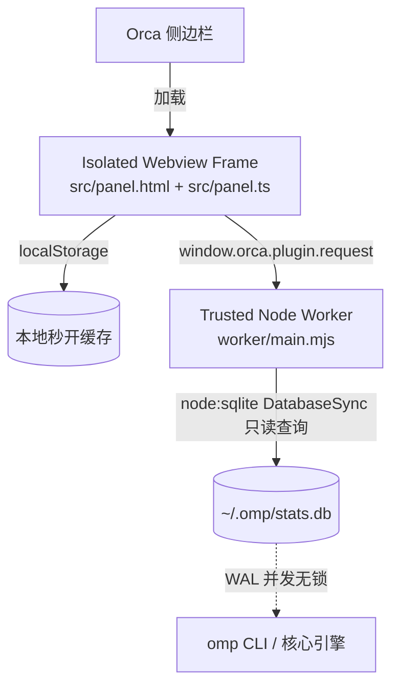

# OMP Stats · Orca 侧边栏插件

[](#)
[](#)
[](#)

将 **omp (Open Multimodal Proxy / AI Coding Agent)** 官方遥测看板（`http://127.0.0.1:59127/`）原生内嵌至 Orca 右侧边栏。直接以只读模式并发挂载 `~/.omp/stats.db`，实现 **~9ms 极致查库**、**毫秒级秒开渲染**与 **1:1 像素级视觉对齐**。

---

## 界面概览

### 顶部全局工具栏

```
┌────────────────────────────────────────────────────────┐
│ [ ● Live                58m ago ] [ ⟳ 刷新 ] ┌────────┐│
│ ├──────────────────────────────────────────┤ │        ││
│ [  1h  |  24h  |  7d  |  30d  |  90d | All ] │ │   π  ││
│ └──────────────────────────────────────────┘ └────────┘│
│  Overview  |  Models (7)                               │
└────────────────────────────────────────────────────────┘
```

- **左右完全对齐**：状态芯片、手动刷新按钮与时间范围胶囊左右边框上下像素级对齐（x = 439）。
- **实时状态芯片**：呼吸绿点展示最后更新时间，支持点击刷新。
- **手动刷新按钮**：带 `⟳` 顺时针旋转动画与 `刷新中…` 状态反馈。
- **6 级时间窗**：`1h`（5 分钟桶）、`24h`（1 小时桶）、`7d`、`30d`、`90d`、`All`。
- **omp 发光品牌图标**：从 `hero.png` 质心 1:1 提取的品红至蓝紫渐变几何 Monogram，带霓虹微光。

---

## 核心功能与视图

### 1. Overview（总览视图）

对齐 `http://127.0.0.1:59127/#/overview`：

- **5 张主 KPI 指标卡（带 SVG 面积折线）**：
  - `API-equivalent cost`：公有云 API 等效成本（含品红折线与未计价请求统计）
  - `Requests`：请求总量、失败次数（青色折线）
  - `Conversation tokens`：对话总 Token 数、输出 Token 数（青色折线）
  - `Cache rate`：缓存命中率与节约比例
  - `Error rate`：错误率与成功请求数（红色折线）
- **8 格次级指标条（2×4 紧凑网格）**：
  `Uncached input`｜`Cache read`｜`Cache write`｜`Output`｜`Premium reqs`｜`Tokens/s`｜`Avg latency`｜`Avg TTFT`
- **Activity 柱状图**：按时序展示请求柱状分布，支持 `Requests`（含失败红色堆叠）、`Tokens`、`Cost` 三维切换。
- **Token mix & By agent**：四色 Token 构成比例条（未缓存入、缓存读、缓存写、模型输出），以及主/子 Agent 资源占比。
- **Latest requests 表**：展示最近 12 次模型调用的模型、渠道、时间、耗时、Token 数、费用与 `OK` / `Failed` 状态徽章。

---

### 2. Models（模型分析视图）

对齐 `http://127.0.0.1:59127/#/models`：

- **4 张模型核心卡片**：`Models used`（使用的模型数与服务商数）、`Most used`（调用最多模型与占比）、`Requests`（请求折线）、`API-equivalent cost`。
- **Request share 堆叠图**：10 色调色盘，支持 **`Share`（100% 占比面积）** 与 **`Requests`（调用量柱状）** 切换，附带模型图例。
- **All models 多维明细表（双显示模式）**：
  - **紧凑收缩模式 (`Compact`，默认)**：专为侧边栏窄屏定制，5 列零截断无溢出：
    - `Model`：折叠三角 `▸` + 颜色点 + 模型名称 + 服务商与请求数
    - `Errors`：对齐网页版的**语义色状态胶囊**（`0%` 灰暗、`<1%` 绿色、`1-5%` 黄色、`>5%` 红色）
    - `Tokens`：加粗 Token 总量 + 下方缓存率
    - `Speed`：生成速度（`Tokens/s`）+ 下方首字延迟（`TTFT`）
    - `Trend`：每个模型独立的迷你平滑折线图
  - **完整宽表模式 (`Full table`)**：提供水平滚动条，1:1 还原网页版全部 10 列：
    `Model`｜`Requests`｜`Cost`｜`Tokens`｜`Cache rate`｜`Errors`｜`Tokens/s`｜`TTFT`｜`Trend`
- **单行点击展开性能抽屉（Dual-axis Performance Chart）**：
  点击任意模型行即可展开：
  - **Efficiency**：错误率、缓存率、Cache savings、Premium reqs
  - **Latency & Throughput**：平均耗时、Avg TTFT、Tokens/s
  - **Tokens**：输入、缓存读、缓存写、输出明细
  - **双轴折线图**：
    - **左轴实线**：Tokens/s 吞吐折线（模型专属主题色）
    - **右轴虚线**：TTFT 首字延迟折线（灰色点划线）
    - **交互浮层**：悬停任一采样点查看精确吞吐、延迟与请求数

---

## 技术架构



1. **安全沙箱隔离**：前端界面运行在 Electron `<webview>` 隔离环境中，通过 `window.orca` 桥接，不直接读写外部网络。
2. **免构建热加载**：采用 TypeScript 源码分发，Orca 内置 sucrase 实时转译，无需打包器（Webpack/Vite/Rollup），改完即生效。
3. **极速只读查库**：Worker 通过 Node 22+ 原生 `node:sqlite`（`DatabaseSync`）挂载 SQLite WAL 数据库，单次全量聚合耗时 **< 10ms**，不影响 omp 正在进行的写入。
4. **两级韧性缓存**：`localStorage` 保证切回插件时 0 毫秒秒开历史帧；Worker 保证数据与磁盘保持秒级同步。

---

## 目录结构

```
plugins/omp-usage/
├── orca-plugin.json           # 插件清单 (trusted-worker 档位，声明 panel)
├── README.md                  # 插件说明文档
├── tsconfig.json              # TypeScript 配置 (继承 .orca/types)
├── .gitignore
├── .gitattributes
├── src/
│   ├── panel.html             # 遵循 omp stats CSS 设计系统的面板骨架
│   ├── panel.ts               # 前端主控制器 (状态管理、路由与事件分发)
│   ├── protocol.ts            # 面板与 Worker 之间的双向类型契约
│   ├── format.ts              # 格式化函数 (Tokens/s, TTFT, 错误胶囊, 紧凑数值)
│   ├── overview-cards.ts      # Topbar、KPI 指标卡与 Activity 柱状图
│   ├── overview-sections.ts   # Token mix 分布图与 Latest requests 列表
│   ├── models-tab.ts          # Models 子 Tab 页面骨架与 Request share 堆叠图
│   ├── models-table.ts        # All models 表格 (Compact 紧凑与 Full table 宽表模式)
│   ├── models-detail.ts       # 模型展开抽屉与双轴 TTFT/吞吐折线图
│   └── assets/
│       └── omp-logo.png       # 1:1 提取的 128x128 Retina 几何品牌图标
└── worker/
    ├── main.mjs               # Worker 启动入口 (激活 RPC 监听)
    └── omp-stats-db.mjs       # 基于 node:sqlite 对接 ~/.omp/stats.db 的 SQL 引擎
```

---

## 本地开发与调试

```sh
# 1. 进入插件目录并载入 Orca 本地开发环境
cd plugins/omp-usage
orca plugin dev watch .

# 2. 类型检查 (需已生成 .orca/types)
npx tsc -p .

# 3. 代码质量与格式化检查
pnpm exec oxlint src worker
pnpm exec oxfmt --check src worker

# 4. 验证清单与文件完整性
pnpm validate:plugin plugins/omp-usage

# 5. 无头截图测试 (验证渲染结果)
orca plugin shot local.omp-usage
```
